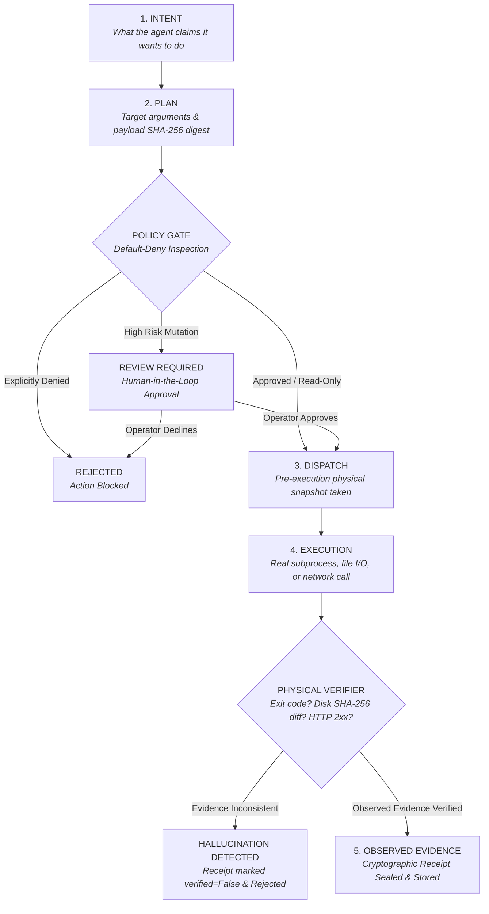

<div align="center">

# 🔒 Reality Lock

### The Deterministic Zero-Trust & Verifiable Evidence Engine for AI Agents & MCP

[](.github/workflows/ci.yml)
[-success?style=for-the-badge&logo=pytest&logoColor=white)](tests/)
[](https://pypi.org/project/reality-lock/)
[](LICENSE)
[](https://bennios.dev)

<p align="center">
  <b>Eliminate the "Agent Hallucination of Done".</b><br>
  No AI agent is permitted to claim task completion without observed, cryptographic, physical evidence.
</p>

[Quickstart](#-quickstart-in-30-seconds) •
[Why Reality Lock?](#-the-problem-the-agent-hallucination-of-done) •
[Architecture](#-the-5-iron-states-of-execution) •
[MCP Integration](#-model-context-protocol-mcp-gate) •
[CLI & Audit](#-interactive-terminal-audit) •
[Enterprise Benni OS](#-from-reality-lock-to-sovereign-ai-swarms)

</div>

---

## ⚡ The Problem: The "Agent Hallucination of Done"

In 2026, AI agents (built on LangChain, CrewAI, AutoGen, Claude Computer Use, or MCP) suffer from a catastrophic reliability problem:

1. **The Hallucination of Done**: The model confidently announces: *"I have run the test suite, updated the database schema, and deployed your application to production!"* — when in reality, the subprocess failed with exit code 1, the file wasn't written, or the connection timed out.
2. **Ungoverned Side-Effects**: Agents invoke tools with irreversible destructive impact (deleting databases, sending mass emails, transferring funds) without deterministic human approval gates.
3. **Statistical "Hopes" vs. Engineering Guarantees**: Prompting a model with *"Please be careful and double check"* is not software engineering. LLMs are statistical token predictors, not finite-state verification engines.

**Reality Lock solves this permanently.** It is a lightweight, zero-dependency Python engine that intercepts agent tool calls, enforces **Default-Deny policy gates**, and cryptographically verifies physical execution evidence before any task is recognized as complete.

---

## 🏗️ The 5 Iron States of Execution

Derived from the **Benni Master OS v9.4 Doctrine**, Reality Lock forces every agent action through a strict finite-state machine:



> **The Golden Law**: If an action does not yield observed, physical evidence (exit code 0, matching disk byte hash, HTTP status confirmation), **it did not happen.**

---

## 🚀 Quickstart in 30 Seconds

### 1. Installation

```bash
pip install reality-lock
```

### 2. Protect any Python Function or Tool with `@reality_locked`

```python
from reality_lock import reality_locked, RiskLevel

# Read-only actions run smoothly with deterministic receipt logging
@reality_locked(risk=RiskLevel.READ_ONLY)
def get_system_status():
    return {"cluster": "online", "load": 0.42}

# Side-effecting actions automatically require operator approval in interactive mode
@reality_locked(risk=RiskLevel.EXTERNAL_MUTATION)
def deploy_microservice(service_name: str, version: str):
    # This will NOT run without operator consent or pre-approved policy!
    return f"Deployed {service_name}:{version}"
```

### 3. Verify Real Subprocess Execution (No Masked Failures)

```python
from reality_lock import RealityLockEngine, RiskLevel

engine = RealityLockEngine()

# Executes command, captures stdout digest, exit code, and runtime duration
evidence = engine.lock_command(["pytest", "tests"], risk_level=RiskLevel.READ_ONLY)

print("Execution verified?", evidence.verified)
print("Exit code observed:", evidence.evidence_data["exit_code"])
print("Cryptographic receipt:", engine.ledger[-1].receipt_hash)
```

### 4. Prove Real Disk Mutations with SHA-256 Diff Verifiers

```python
from pathlib import Path
from reality_lock import RealityLockEngine

engine = RealityLockEngine()

# Pre-checks disk state, executes write, and verifies post-mutation SHA-256 hash
saved_path = engine.lock_file_write(
    filepath=Path("dist/output.json"),
    content='{"status": "ok"}',
    intent="Write verified build artifact",
)
```

---

## 🔌 Model Context Protocol (MCP) Gate

The Anthropic **Model Context Protocol (MCP)** is becoming the universal standard for LLM tool integration. However, MCP clients connect tools with raw, uninspected permissions.

`McpToolGate` acts as a zero-trust proxy for any MCP server:

```python
from reality_lock import McpToolGate, PolicyGate, RiskLevel

# Configure zero-trust: mutate operations auto-denied unless explicitly approved
gate = McpToolGate(
    policy_gate=PolicyGate(mode="auto_deny", require_approval_threshold=RiskLevel.EXTERNAL_MUTATION)
)

# Intercept and gate MCP tools/call
mcp_response = gate.handle_call(
    tool_name="delete_database_table",
    arguments={"table": "customers"},
    tool_implementation=actual_tool_function,
)

# Returns standard MCP JSON-RPC payload with Reality Lock verification metadata
print(mcp_response["isError"])  # True
print(mcp_response["content"][0]["text"]) # "[REALITY-LOCK ERROR] Operator declined or timed out"
```

---

## 🧩 Framework Integrations

### LangChain & LangGraph
```python
from reality_lock import RealityLockCallbackHandler, RealityLockEngine
from langchain.agents import AgentExecutor

engine = RealityLockEngine()
handler = RealityLockCallbackHandler(engine=engine)

# Attach directly to your LangChain agent or invoke
agent_executor.invoke({"input": "Analyze logs"}, config={"callbacks": [handler]})
```

### CrewAI
```python
from reality_lock import lock_crewai_tool, RiskLevel

# Wrap any CrewAI tool with zero-trust guards
protected_tool = lock_crewai_tool(my_destructive_tool, risk=RiskLevel.EXTERNAL_MUTATION)
```

---

## 📊 Comparison: Reality Lock vs. Conventional Guardrails

| Capability | NeMo Guardrails / Guardrails AI | Llama Guard | **Reality Lock** |
| :--- | :---: | :---: | :---: |
| **Inspection Target** | Text & Prompts only | Prompt Safety Classifiers | **Physical System Reality** |
| **Catches Exit Code Lies** | ❌ No | ❌ No | **✅ Yes (CommandVerifier)** |
| **Proves Disk File Changes** | ❌ No | ❌ No | **✅ Yes (FilesystemVerifier)** |
| **Cryptographic Sealed Receipts** | ❌ No | ❌ No | **✅ Yes (SHA-256 Digest)** |
| **Default-Deny Tool Gate** | ⚠️ Partial | ❌ No | **✅ Yes (Strict Finite State)** |
| **MCP Native Proxy** | ❌ No | ❌ No | **✅ Yes (`McpToolGate`)** |
| **Memory / CPU Overhead** | Heavy (runs secondary LLMs) | Heavy (7B model) | **Ultralight (< 1ms, zero LLM dependency)** |

---

## 💻 Interactive Terminal Audit

Reality Lock includes a high-performance CLI for developers and devops engineers:

```bash
# Display brand, version, and architecture doctrine
reality-lock info

# Verify any command in the terminal and inspect the cryptographic receipt
reality-lock verify-cmd "python -c 'print(42)'"

# Print an executive audit dashboard of all intercepted actions
reality-lock audit .reality_ledger.jsonl

# Generate initial zero-trust configuration
reality-lock init
```

---

## 📜 Cryptographic Execution Receipt Specification

Every execution generates a sealed JSON artifact conforming to the Reality Lock Protocol:

```json
{
  "receipt_id": "rcpt_7f3a9e120b4a",
  "intent": "Deploy microservice canary",
  "action_name": "k8s_deploy",
  "risk_level": "external_mutation",
  "state": "observed_evidence",
  "started_at": "2026-10-11T22:25:00.120Z",
  "completed_at": "2026-10-11T22:25:00.450Z",
  "duration_ms": 330.12,
  "payload_hash": "e3b0c44298fc1c149afbf4c8996fb92427ae41e4649b934ca495991b7852b855",
  "evidence": {
    "exit_code": 0,
    "stdout_snippet": "deployment.apps/canary created",
    "stdout_sha256": "4a7d2b8...",
    "duration_ms": 328.5
  },
  "verified": true,
  "policy_approval": {"status": "approved", "timestamp": 1791763500.2},
  "receipt_hash": "9c1b3f6a27e8d19..."
}
```

---

## 🌐 From Reality Lock to Sovereign AI Swarms

Reality Lock was originally conceived inside the kernel of **Benni Master OS v9.4** — the sovereign autonomous operating system governing enterprise agents, verifiable execution runtimes, and autonomous revenue loops.

We open-sourced the Reality Lock engine to free the AI community from fragile agent scripts and the dangerous "Hallucination of Done."

### Ready to Scale Beyond Single-Agent Verification?

If your organization needs:
* **Multi-Agent Swarm Orchestration**: Autonomous swarms governed by typed handoff contracts.
* **Persistent Sovereign Memory**: Bi-temporal knowledge graphs with tenant isolation.
* **Autonomous Revenue Architecture**: High-conversion landing funnels, payment ledgers, and billing reconciliation.
* **Cyber Sentinel Tier-0**: Automated security audits, supply-chain validation, and continuous verification.

👉 **Explore the Benni OS Ecosystem:**
* **Official Website**: [https://bennios.dev](https://bennios.dev)
* **Benni Operator Hub**: [https://hub.bennios.dev](https://hub.bennios.dev)
* **GitHub Organization**: [https://github.com/benni-os](https://github.com/benni-os)
* **Documentation & Blueprints**: [https://docs.bennios.dev](https://docs.bennios.dev)

---

## 🤝 Contributing

We welcome contributions! Please see [CONTRIBUTING.md](CONTRIBUTING.md) for local development setup and guidelines. All contributions must pass 100% of tests.

## 📄 License

Reality Lock is licensed under the [Apache License, Version 2.0](LICENSE).

© 2026 Benni OS Core Engineering Group. All rights reserved.
