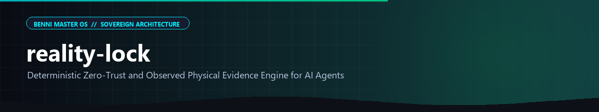
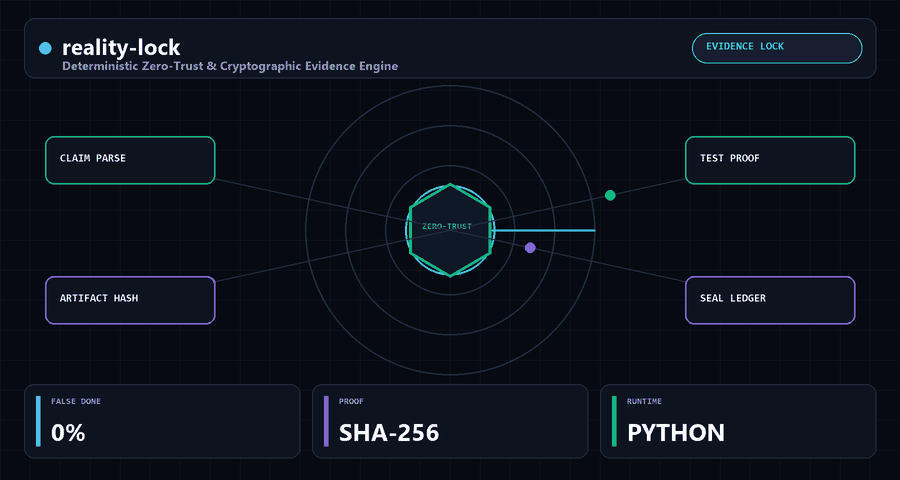
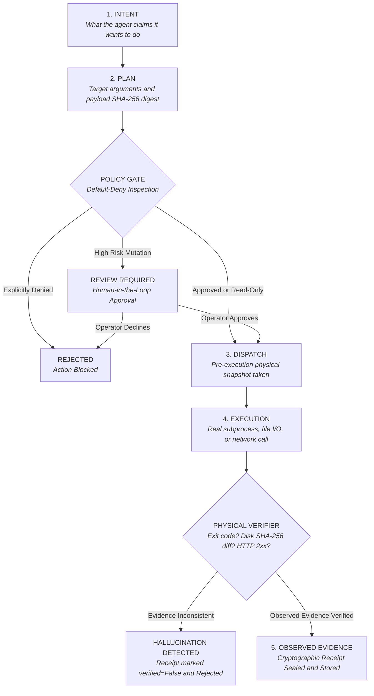

<div align="center">



<br/>


<br/><br/>

[](https://pypi.org/project/reality-lock/)
[](https://github.com/BenniAlencar/reality-lock/actions/workflows/ci.yml)
[](tests/)
[](https://www.python.org/)
[](https://modelcontextprotocol.io/)
[](LICENSE)
[](https://github.com/BenniAlencar)
[](https://benni-os.net)

<br/>

> **"If an action does not yield observed, physical evidence — exit code 0, matching disk byte hash, HTTP status confirmation — it did not happen."**


<p align="center">
  <b>Eliminate the "Agent Hallucination of Done".</b><br>
  No AI agent is permitted to claim task completion without observed, cryptographic, physical evidence.
</p>

<br/>



<br/><br/>

[Quickstart](#-quickstart-in-30-seconds) •
[Why Reality Lock?](#-the-problem-the-agent-hallucination-of-done) •
[Architecture](#-the-5-iron-states-of-execution) •
[MCP Integration](#-model-context-protocol-mcp-gate) •
[CLI & Audit](#-interactive-terminal-audit) •
[Enterprise Benni OS](#-from-reality-lock-to-sovereign-ai-swarms)

</div>

<br/>

## ⚡ The Problem: The "Agent Hallucination of Done"

In 2026, AI agents (built on LangChain, CrewAI, AutoGen, Claude Computer Use, or MCP) suffer from a catastrophic reliability problem:

1. **The Hallucination of Done**: The model confidently announces: *"I have run the test suite, updated the database schema, and deployed your application to production!"* — when in reality, the subprocess failed with exit code 1, the file wasn't written, or the connection timed out.
2. **Ungoverned Side-Effects**: Agents invoke tools with irreversible destructive impact (deleting databases, sending mass emails, transferring funds) without deterministic human approval gates.
3. **Statistical "Hopes" vs. Engineering Guarantees**: Prompting a model with *"Please be careful and double check"* is not software engineering. LLMs are statistical token predictors, not finite-state verification engines.

**Reality Lock solves this permanently.** It is a lightweight, zero-dependency Python engine that intercepts agent tool calls, enforces **Default-Deny policy gates**, and cryptographically verifies physical execution evidence before any task is recognized as complete.

<br/>


## 🏗️ The 5 Iron States of Execution

Derived from the **Benni Master OS v9.4 Doctrine**, Reality Lock forces every agent action through a strict finite-state machine:

```text
  LangChain / CrewAI / MCP Clients / @reality_locked Python Functions
         │
         ├──► RealityLockEngine.execute / lock_command
         └──► McpToolGate (JSON-RPC 2.0 Zero-Trust Gate)
                       │
                       ▼
  ┌─────────────────────────────────────────────────────────────────────┐
  │                            reality-lock                             │
  │                                                                     │
  │  ┌───────────────────┐  ┌───────────────────┐  ┌─────────────────┐  │
  │  │ Default-Deny      │  │  5-State Engine   │  │ Physical        │  │
  │  │ PolicyGate        │─►│  INTENT -> PLAN   │─►│ Verifiers       │  │
  │  │ • RiskLevel       │  │  -> DISPATCH      │  │ • Command       │  │
  │  │ • Human Approval  │  │  -> EXECUTION     │  │ • Filesystem    │  │
  │  └───────────────────┘  └───────────────────┘  │ • HTTP 2xx      │  │
  │                                                └─────────────────┘  │
  │  ┌───────────────────┐  ┌───────────────────┐  ┌─────────────────┐  │
  │  │ Cryptographic     │  │  Framework        │  │ Tools & CLI     │  │
  │  │ ExecutionReceipt  │  │  Adapters         │  │ • doctor        │  │
  │  │ • SHA-256 Seal    │  │  • @reality_locked│  │ • bench_matrix  │  │
  │  │ • Tamper Check    │  │  • LangChain/Crew │  │ • verify-cmd    │  │
  │  └───────────────────┘  └───────────────────┘  └─────────────────┘  │
  └─────────────────────────────────────────────────────────────────────┘
         │                                         │
         ▼                                         ▼
   Physical Evidence Ledger                 SHA-256 ExecutionReceipt
   (.reality_ledger.jsonl)                  Zero Hallucination of Done
```

See [docs/ARCHITECTURE.md](docs/ARCHITECTURE.md) for the full internal specification.



> **The Golden Law**: If an action does not yield observed, physical evidence (exit code 0, matching disk byte hash, HTTP status confirmation), **it did not happen.**

<br/>


## 🚀 Quickstart in 30 Seconds

### 1. Installation

```bash
pip install reality-lock
```

### 2. Protect any Python Function or Tool with `@reality_locked`

```python
from reality_lock import reality_locked, RiskLevel

# Read-only actions run smoothly with deterministic receipt logging
@reality_locked(risk=RiskLevel.READ_ONLY)
def get_system_status():
    return {"cluster": "online", "load": 0.42}

# Side-effecting actions automatically require operator approval in interactive mode
@reality_locked(risk=RiskLevel.EXTERNAL_MUTATION)
def deploy_microservice(service_name: str, version: str):
    # This will NOT run without operator consent or pre-approved policy!
    return f"Deployed {service_name}:{version}"
```

### 3. Verify Real Subprocess Execution (No Masked Failures)

```python
from reality_lock import RealityLockEngine, RiskLevel

engine = RealityLockEngine()

# Executes command, captures stdout digest, exit code, and runtime duration
evidence = engine.lock_command(["pytest", "tests"], risk_level=RiskLevel.READ_ONLY)

print("Execution verified?", evidence.verified)
print("Exit code observed:", evidence.evidence_data["exit_code"])
print("Cryptographic receipt:", engine.ledger[-1].receipt_hash)
```

### 4. Prove Real Disk Mutations with SHA-256 Diff Verifiers

```python
from pathlib import Path
from reality_lock import RealityLockEngine

engine = RealityLockEngine()

# Pre-checks disk state, executes write, and verifies post-mutation SHA-256 hash
saved_path = engine.lock_file_write(
    filepath=Path("dist/output.json"),
    content='{"status": "ok"}',
    intent="Write verified build artifact",
)
```

<br/>


## 🔌 Model Context Protocol (MCP) Gate

The Anthropic **Model Context Protocol (MCP)** is becoming the universal standard for LLM tool integration. However, MCP clients connect tools with raw, uninspected permissions.

`McpToolGate` acts as a zero-trust proxy for any MCP server:

```python
from reality_lock import McpToolGate, PolicyGate, RiskLevel

# Configure zero-trust: mutate operations auto-denied unless explicitly approved
gate = McpToolGate(
    policy_gate=PolicyGate(mode="auto_deny", require_approval_threshold=RiskLevel.EXTERNAL_MUTATION)
)

# Intercept and gate MCP tools/call
mcp_response = gate.handle_call(
    tool_name="delete_database_table",
    arguments={"table": "customers"},
    tool_implementation=actual_tool_function,
)

# Returns standard MCP JSON-RPC payload with Reality Lock verification metadata
print(mcp_response["isError"])  # True
print(mcp_response["content"][0]["text"]) # "[REALITY-LOCK ERROR] Operator declined or timed out"
```

<br/>


## 🧩 Framework Integrations

### LangChain & LangGraph
```python
from reality_lock import RealityLockCallbackHandler, RealityLockEngine
from langchain.agents import AgentExecutor

engine = RealityLockEngine()
handler = RealityLockCallbackHandler(engine=engine)

# Attach directly to your LangChain agent or invoke
agent_executor.invoke({"input": "Analyze logs"}, config={"callbacks": [handler]})
```

### CrewAI
```python
from reality_lock import lock_crewai_tool, RiskLevel

# Wrap any CrewAI tool with zero-trust guards
protected_tool = lock_crewai_tool(my_destructive_tool, risk=RiskLevel.EXTERNAL_MUTATION)
```

<br/>


## 📊 Comparison: Reality Lock vs. Conventional Guardrails

| Capability | NeMo Guardrails / Guardrails AI | Llama Guard | **Reality Lock** |
| :--- | :---: | :---: | :---: |
| **Inspection Target** | Text & Prompts only | Prompt Safety Classifiers | **Physical System Reality** |
| **Catches Exit Code Lies** | ❌ No | ❌ No | **✅ Yes (`CommandVerifier`)** |
| **Proves Disk File Changes** | ❌ No | ❌ No | **✅ Yes (`FilesystemVerifier`)** |
| **Cryptographic Sealed Receipts** | ❌ No | ❌ No | **✅ Yes (SHA-256 Digest)** |
| **Default-Deny Tool Gate** | ⚠️ Partial | ❌ No | **✅ Yes (Strict Finite State)** |
| **MCP Native Proxy** | ❌ No | ❌ No | **✅ Yes (`McpToolGate`)** |
| **Memory / CPU Overhead** | Heavy (runs secondary LLMs) | Heavy (7B model) | **Ultralight (< 1ms, zero LLM dependency)** |

<br/>


## 💻 Interactive Terminal Audit

Reality Lock includes a high-performance CLI for developers and devops engineers:

```bash
# Display brand, version, and architecture doctrine
reality-lock info

# Verify any command in the terminal and inspect the cryptographic receipt
reality-lock verify-cmd "python -c 'print(42)'"

# Print an executive audit dashboard of all intercepted actions
reality-lock audit .reality_ledger.jsonl

# Generate initial zero-trust configuration
reality-lock init

# Probe runtime environment, PolicyGate, physical verifiers & receipt sealing
reality-lock doctor

# Run multi-mode receipt verification throughput benchmark matrix
reality-lock matrix --actions 25,100,250
```

<br/>


## 📁 Project Structure

```text
reality-lock/
├── docs/
│   └── ARCHITECTURE.md                  # Skill 62 5-state zero-trust specification
├── examples/
│   ├── 01_quickstart_function.py        # @reality_locked function decorator guard
│   ├── 02_command_with_evidence.py      # Subprocess execution with CommandVerifier
│   ├── 03_file_mutation_guard.py        # Disk SHA-256 verification with FilesystemVerifier
│   ├── 04_mcp_security_proxy.py         # Model Context Protocol (MCP) zero-trust gate
│   └── 05_langchain_agent_guard.py      # LangChain callback handler integration
├── reality_lock/
│   ├── __init__.py                      # Public package exports
│   ├── py.typed                         # PEP 561 type marker
│   ├── version.py                       # Version, doctrine & maintainer metadata
│   ├── adapters/
│   │   ├── __init__.py                  # Adapter exports
│   │   ├── crewai.py                    # CrewAI tool wrapper
│   │   ├── decorator.py                 # @reality_locked Python decorator
│   │   ├── langchain.py                 # LangChain callback handler
│   │   └── mcp.py                       # Native MCP JSON-RPC 2.0 zero-trust gate
│   ├── cli/
│   │   ├── __init__.py                  # CLI package marker
│   │   └── main.py                      # Click + Rich CLI (info, verify-cmd, audit, init, doctor, matrix)
│   ├── core/
│   │   ├── __init__.py                  # Core engine exports
│   │   ├── engine.py                    # RealityLockEngine 5-state coordinator
│   │   ├── policy.py                    # Default-Deny PolicyGate & HITL approvals
│   │   ├── receipt.py                   # SHA-256 sealed ExecutionReceipt & tamper check
│   │   └── states.py                    # ExecutionState, RiskLevel & PolicyDecision enums
│   ├── tools/
│   │   ├── __init__.py                  # Diagnostics & benchmark tool exports
│   │   ├── bench_matrix.py              # Multi-mode receipt throughput benchmark matrix
│   │   └── doctor.py                    # Environment, PolicyGate & verifier probe
│   └── verifiers/
│       ├── __init__.py                  # Verifier exports
│       ├── base.py                      # Abstract BaseVerifier & EvidenceResult
│       ├── command.py                   # Subprocess exit-code & digest verifier
│       ├── filesystem.py                # Disk existence & SHA-256 mutation verifier
│       └── http.py                      # HTTP 2xx status & header redaction verifier
├── scripts/
│   ├── benchmark_receipt_throughput.py  # In-memory vs JSONL receipt sealing benchmark
│   └── gate_reality_lock_runner.py      # Fail-closed zero-trust & evidence gate runner
└── tests/
    ├── __init__.py                      # Test suite package marker
    ├── conftest.py                      # Shared pytest fixtures
    ├── test_cli.py                      # Click CLI command tests
    ├── test_decorator.py                # @reality_locked decorator tests
    ├── test_engine.py                   # 5-state engine & JSONL persistence tests
    ├── test_mcp_adapter.py              # MCP tool gate & risk inference tests
    ├── test_policy_gate.py              # Default-Deny policy & callback tests
    ├── test_states_and_receipts.py      # Receipt sealing & tamper detection tests
    ├── test_tools_and_scripts.py        # Doctor, bench_matrix & gate script tests
    └── test_verifiers.py                # Command, Filesystem & HTTP verifier tests
```

<br/>


## 📜 Cryptographic Execution Receipt Specification

Every execution generates a sealed JSON artifact conforming to the Reality Lock Protocol:

```json
{
  "receipt_id": "rcpt_7f3a9e120b4a",
  "intent": "Deploy microservice canary",
  "action_name": "k8s_deploy",
  "risk_level": "external_mutation",
  "state": "observed_evidence",
  "started_at": "2026-10-11T22:25:00.120Z",
  "completed_at": "2026-10-11T22:25:00.450Z",
  "duration_ms": 330.12,
  "payload_hash": "e3b0c44298fc1c149afbf4c8996fb92427ae41e4649b934ca495991b7852b855",
  "evidence": {
    "exit_code": 0,
    "stdout_snippet": "deployment.apps/canary created",
    "stdout_sha256": "4a7d2b8...",
    "duration_ms": 328.5
  },
  "verified": true,
  "policy_approval": {"status": "approved", "timestamp": 1791763500.2},
  "receipt_hash": "9c1b3f6a27e8d19..."
}
```

<br/>


## 🌐 The Benni OS Open-Source Ecosystem

`reality-lock` is part of the **Benni OS** decentralized agentic infrastructure. Explore the 17 open-source repositories powering sovereign AI agents:

| Repository | Focus & Architecture | Stars |
| :--- | :--- | :---: |
| **[`conductor-sdd`](https://github.com/Benni-OS/conductor-sdd)** | Zero-Dependency Spec-Driven Development, Static AST Drift Detector & MCP Guardrail | [](https://github.com/Benni-OS/conductor-sdd) |
| **[`benni-inference-engine`](https://github.com/Benni-OS/benni-inference-engine)** | High-Throughput Sovereign Local Inference for 8GB–16GB Consumer GPUs | [](https://github.com/Benni-OS/benni-inference-engine) |
| **[`agent-eval-harness`](https://github.com/BenniAlencar/agent-eval-harness)** | Deterministic Zero-Cloud Agent Evaluation, Red-Teaming & Benchmark Harness | [](https://github.com/BenniAlencar/agent-eval-harness) |
| **[`agent-code-sandbox`](https://github.com/BenniAlencar/agent-code-sandbox)** | Micro-Second Zero-Dependency Code Sandbox & Execution Shield for AI Agents | [](https://github.com/BenniAlencar/agent-code-sandbox) |
| **[`agent-deep-research`](https://github.com/BenniAlencar/agent-deep-research)** | Autonomous Multi-Source Deep Research & Evidence Synthesis Engine | [](https://github.com/BenniAlencar/agent-deep-research) |
| **[`agent-browser-mesh`](https://github.com/BenniAlencar/agent-browser-mesh)** | Token-Saving Resilient Headless Browser Automation & A11y DOM Compiler | [](https://github.com/BenniAlencar/agent-browser-mesh) |
| **[`agent-intent-compiler`](https://github.com/BenniAlencar/agent-intent-compiler)** | Deterministic Intent Compiler & Typed DAG Execution Planner for AI Agents | [](https://github.com/BenniAlencar/agent-intent-compiler) |
| **[`agent-token-optimizer`](https://github.com/BenniAlencar/agent-token-optimizer)** | Sub-Millisecond Context Compression & Semantic Deduplication Engine | [](https://github.com/BenniAlencar/agent-token-optimizer) |
| **[`bio-sync-operator-os`](https://github.com/BenniAlencar/bio-sync-operator-os)** | Real-Time Biometric Swarm Governance & 120 FPS Resonant Kinetic Interface | [](https://github.com/BenniAlencar/bio-sync-operator-os) |
| **[`agent-cyber-sentinel`](https://github.com/BenniAlencar/agent-cyber-sentinel)** | Zero-Trust Runtime Security, Prompt Injection Firewall & Secrets Redaction | [](https://github.com/BenniAlencar/agent-cyber-sentinel) |
| **[`agent-run-ledger`](https://github.com/BenniAlencar/agent-run-ledger)** | Deterministic Multi-Step Task Execution Ledger & Anti-Looping Engine | [](https://github.com/BenniAlencar/agent-run-ledger) |
| **[`reality-lock`](https://github.com/BenniAlencar/reality-lock)** | Cryptographic State Verification & Invariant Proof Engine for Agents | [](https://github.com/BenniAlencar/reality-lock) |
| **[`agent-memory-mesh`](https://github.com/BenniAlencar/agent-memory-mesh)** | Hybrid Vector + BM25 Hierarchical Session Memory & Continuity Engine | [](https://github.com/BenniAlencar/agent-memory-mesh) |
| **[`benni-operator-gateway`](https://github.com/Benni-OS/benni-operator-gateway)** | Human-in-the-Loop Approval & Policy Enforcement Gateway | [](https://github.com/Benni-OS/benni-operator-gateway) |
| **[`mcp-forge`](https://github.com/Benni-OS/mcp-forge)** | Rapid Model Context Protocol (MCP) Server Scaffolding & Dynamic Tooling | [](https://github.com/Benni-OS/mcp-forge) |
| **[`benni-nexus`](https://github.com/Benni-OS/benni-nexus)** | Autonomous Multi-Agent Intent Routing & Swarm Coordination Hub | [](https://github.com/Benni-OS/benni-nexus) |
| **[`community-autopilot`](https://github.com/Benni-OS/community-autopilot)** | Autonomous GitHub Community Triaging & PR Feedback Agent | [](https://github.com/Benni-OS/community-autopilot) |

<br/>


## 🏛️ Commercial & Sovereign Architecture

This open-source stack serves as the decentralized foundation for the **Benni OS** autonomous swarm kernel and commercial engineering platform:

* **Benni OS Official Platform**: [https://benni-os.net](https://benni-os.net)
* **Benni OS Engineering Academy**: [https://benni-os.net/blog/academy.html](https://benni-os.net/blog/academy.html)
* **Benni OS GitHub Organization**: [https://github.com/Benni-OS](https://github.com/Benni-OS)
* **Lead Architect & Maintainer**: [https://github.com/BenniAlencar](https://github.com/BenniAlencar)

<br/>


## 🤝 Contributing

We welcome contributions! Please see [CONTRIBUTING.md](CONTRIBUTING.md) for local development setup and guidelines. All contributions must pass 100% of tests.

## 📄 License & Provenance

Reality Lock is licensed under the [Apache License, Version 2.0](LICENSE).

© 2026 [Benni OS](https://benni-os.net) Core Engineering Group — Engineered by [Benni Alencar](https://github.com/BenniAlencar). All rights reserved.

<br/>

<div align="center">


**reality-lock** — *Part of the [Benni OS](https://benni-os.net) Core Engineering Group*

`REALITY_LOCK` • `SKILL_62_NATIVE` • `ZERO_TRUST_MCP` • `OBSERVED_EVIDENCE` • `APACHE_2.0`

Engineered by [**Benni Alencar**](https://github.com/BenniAlencar) & the [**Benni OS**](https://github.com/Benni-OS) Core Engineering Group

</div>
